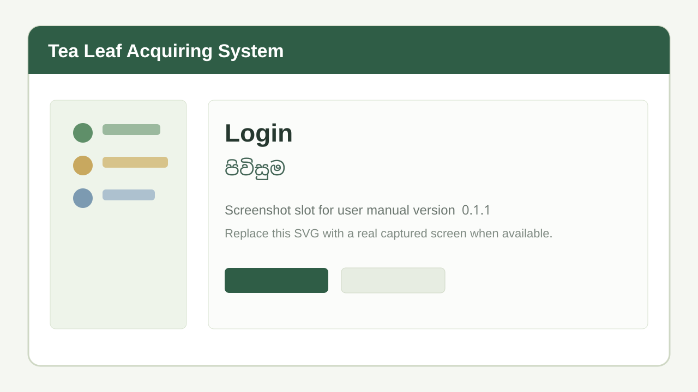
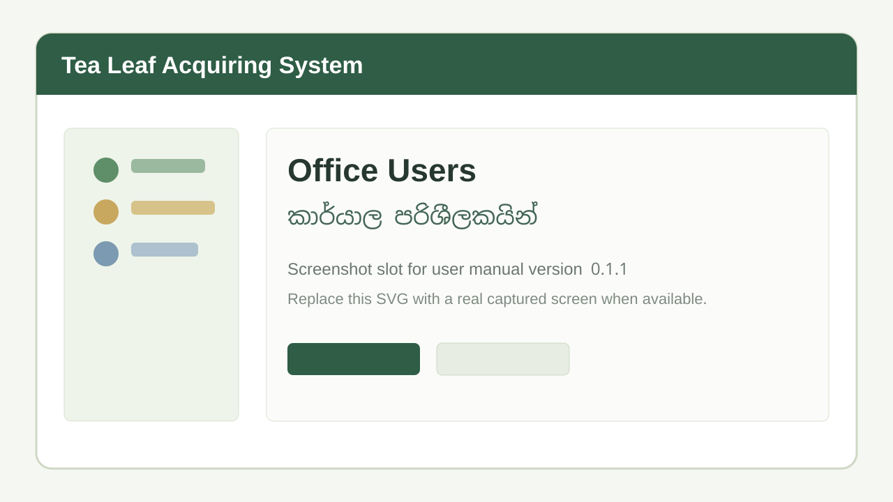
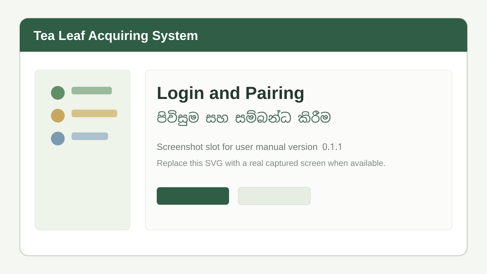
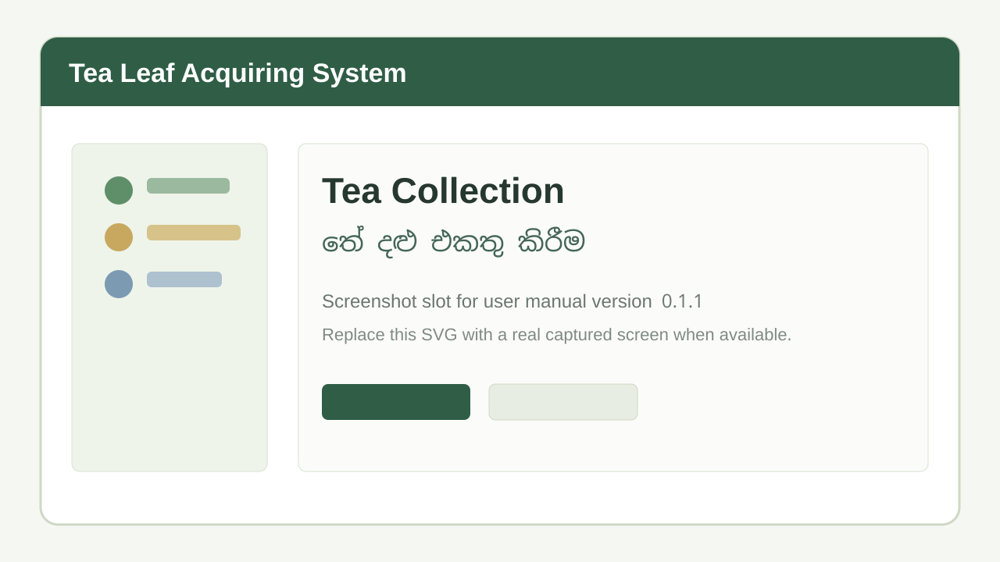
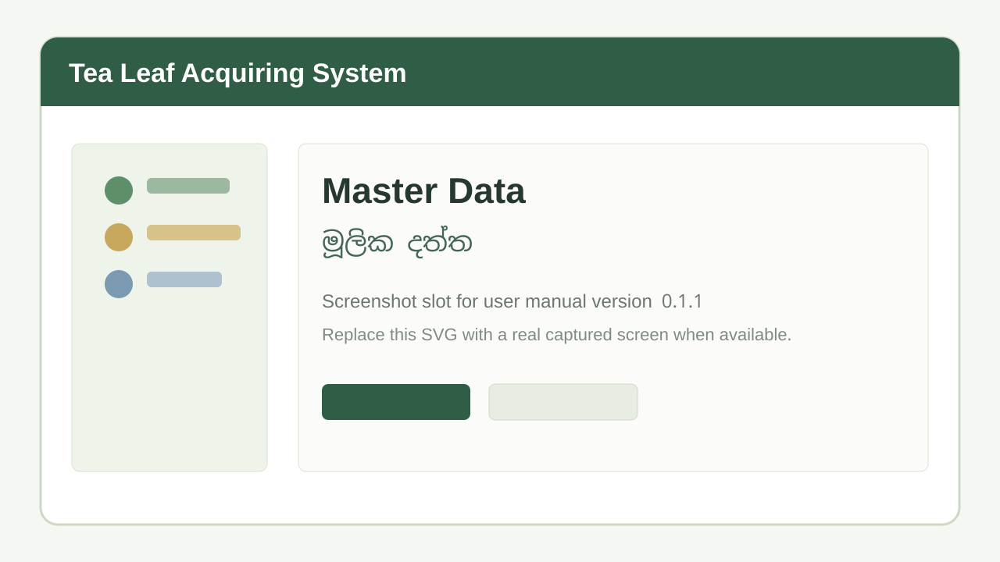
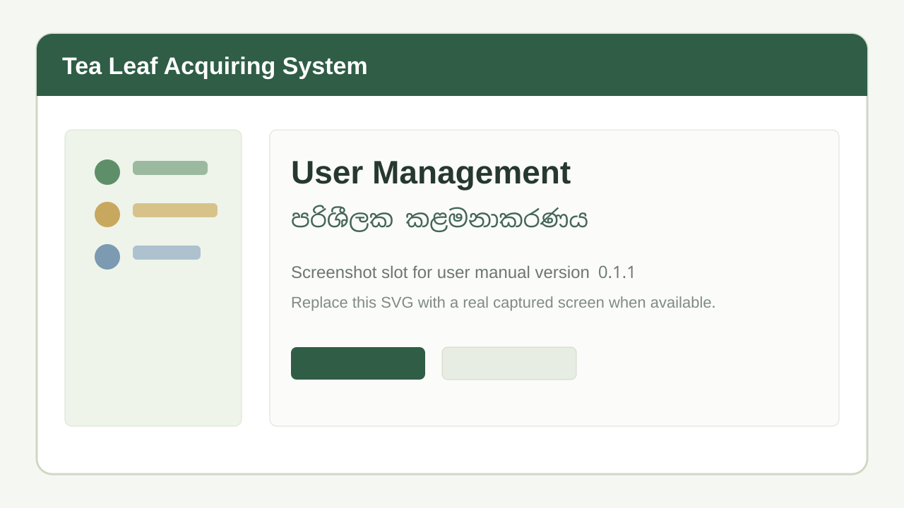
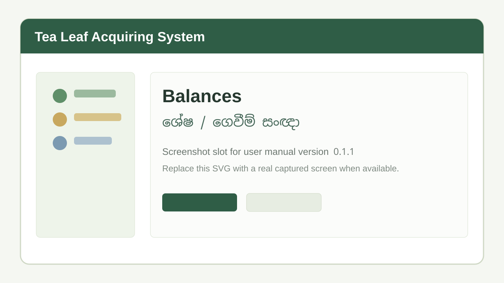
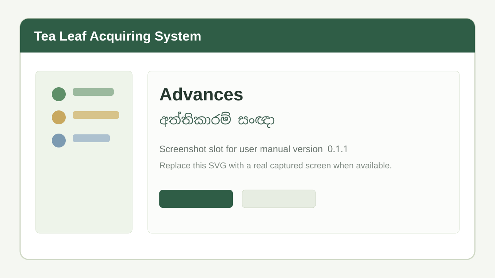

# Tea Leaf Acquiring System User Manual / පරිශීලක මාර්ගෝපදේශය

Version / අනුවාදය: `0.1.1`

This manual explains how each user should operate the Tea Leaf Acquiring System across the three user-facing applications: Desktop App, Android Tablet App, and Web App.

මෙම මාර්ගෝපදේශය Tea Leaf Acquiring System හි Desktop App, Android Tablet App, සහ Web App යන යෙදුම් තුන භාවිතා කරන සියලු පරිශීලකයින් සඳහා ක්‍රියාකාරකම් පියවරෙන් පියවර විස්තර කරයි.

## Screenshot Note / තිර රූ සටහන

The images in `docs/assets/user-manual/v0.1.1/` are stable screenshot slots for this manual. When real version `0.1.1` screenshots are captured from the installed apps, replace the matching files without changing the Markdown links.

`docs/assets/user-manual/v0.1.1/` තුළ ඇති රූප මෙම manual එකේ screenshot ස්ථාන වේ. සැබෑ version `0.1.1` screenshot ලබාගත් පසු Markdown link වෙනස් නොකර අදාල file එක පමණක් replace කරන්න.

## User Roles / පරිශීලක භූමිකා

| Application / යෙදුම | User / පරිශීලකයා | Main responsibility / ප්‍රධාන වගකීම |
| --- | --- | --- |
| Desktop App | Desktop Admin / ඩෙස්ක්ටොප් ඇඩ්මින් | Configure office users, hosted sync settings, restore backups, reopen closed months. |
| Desktop App | Office User / කාර්යාල පරිශීලක | Daily office work, suppliers, monthly work, tablet sync review, payments, reports, backup upload. |
| Android Tablet App | Line User / ලයින් පරිශීලක | Collect green leaf records offline, print receipts, upload records to desktop. |
| Web App | Super Admin / සුපර් ඇඩ්මින් | Manage web users, view reports, manage all web signals, review audit trail. |
| Web App | Director / අධ්‍යක්ෂ | View web reports and create balance/advance signals for office users. |
| Web App | Office User / කාර්යාල පරිශීලක | View synced reports and mark director/admin signals as read after action. |

Default accounts are available for first setup and testing, but passwords must be changed before production use.

මුල් setup/testing සඳහා default accounts තිබුණත් production භාවිතයට පෙර passwords අනිවාර්යයෙන් වෙනස් කරන්න.

## 1. Desktop App / ඩෙස්ක්ටොප් යෙදුම

The Desktop App is the main offline office system. It stores the local SQLite database, receives tablet uploads, calculates the Green Leaf Book, records monthly payments, and sends selected data to the hosted web backend when internet is available.

Desktop App එක ප්‍රධාන offline office system එකයි. Tablet upload ලබාගැනීම, Green Leaf Book ගණනය කිරීම, monthly payments සටහන් කිරීම, සහ internet ඇති විට web backend වෙත sync කිරීම මෙහි සිදු වේ.

### 1.1 Login, Dashboard, Logout / පිවිසුම, ප්‍රධාන පුවරුව, පිටවීම



1. Open Tea Leaf Acquiring System from the Windows desktop or Start menu.
2. Enter your desktop username and password.
3. Select `Login`.
4. Use the sidebar or dashboard shortcut cards to open work areas.
5. To open your profile, select the user button in the header.
6. To leave the system safely, select `Logout`.

1. Windows desktop හෝ Start menu එකෙන් Tea Leaf Acquiring System open කරන්න.
2. Desktop username සහ password ඇතුළත් කරන්න.
3. `Login` තෝරන්න.
4. Sidebar හෝ dashboard shortcut card මඟින් අවශ්‍ය screen එක open කරන්න.
5. Profile open කිරීමට header එකේ user button තෝරන්න.
6. පද්ධතියෙන් පිටවීමට `Logout` තෝරන්න.


The desktop sidebar is grouped as:

- Home: Dashboard.
- Monthly Work: Tea Lines, Suppliers, Advances, Fertilizer, Made Tea Packets, Monthly Settings, Green Leaf Book, Sync to Web App, Supplier Bills, Balance Payment, Office Users.
- Sync & Records: Pair Tablet, Line Users, Staging Review, Collection Records, Cloud DB Backup.
- Reports: Audit Reports.

### 1.2 Profile Management / පැතිකඩ කළමනාකරණය

All logged-in desktop office users can update their own display name and password.

1. Select the user button in the header.
2. Review the username and role.
3. Change the display name if required.
4. Enter a new password only when the password should change.
5. Select `Update profile`.
6. Logout and login again if the password was changed.

සියලු logged-in desktop office users තම display name සහ password update කළ හැක.

### 1.3 Desktop Admin Functions / ඩෙස්ක්ටොප් ඇඩ්මින් ක්‍රියාකාරකම්

#### Office Users / කාර්යාල පරිශීලකයින්



Desktop Admin users can create and manage desktop office user accounts. Regular office users can only view the Office Users list.

1. Login as a Desktop Admin.
2. Open `Office Users`.
3. Enter username, display name, and password.
4. Select `Save office user`.
5. To update a user, select the row edit action.
6. Change display name, username, password, or active status.
7. Save the edit.
8. Deactivate a user when the user should no longer log in.

Desktop Admin පරිශීලකයින්ට desktop office user accounts create/manage කළ හැක. සාමාන්‍ය office users සඳහා මෙය read-only list එකක් වේ.

#### Sync Configuration / සින්ක් සැකසුම්

Only Desktop Admin users can configure the hosted backend URL and cloud sync token.

1. Open `Sync to Web App`.
2. In the setup section, enter the hosted backend URL, for example `https://api.example.com`.
3. Enter or update the cloud sync token only when needed.
4. Save the configuration.
5. Run a test sync.

Important: The same hosted backend URL and `CLOUD_SYNC_TOKEN` are used by both `Sync to Web App` and `Cloud DB Backup`.

වැදගත්: `Sync to Web App` සහ `Cloud DB Backup` දෙකම එකම hosted backend URL සහ `CLOUD_SYNC_TOKEN` භාවිතා කරයි.

#### Restore Cloud DB Backup / ක්ලවුඩ් DB උපස්ථය නැවත ලබාගැනීම

Only Desktop Admin users should restore a cloud backup, normally on a replacement computer or after serious local database damage.

1. Install and open the Desktop App on the target computer.
2. Login as Desktop Admin.
3. Configure the same backend URL and cloud sync token used by the original office computer.
4. Open `Cloud DB Backup`.
5. Select `Check latest backup`.
6. Confirm the latest backup date and size.
7. Select `Restore latest cloud backup`.
8. Login again after the app clears existing desktop sessions.
9. Check Green Leaf Book, Collection Records, and Audit Reports before continuing daily work.

Restore කිරීම replacement computer එකකදී හෝ local database issue එකකදී පමණක් කරන්න. Restore කිරීමේදී current database එක backup copy එකක් ලෙස තබා latest cloud backup එක active database එකට replace කරයි.

#### Reopen Closed Green Leaf Book Month / වසා ඇති මාසයක් නැවත විවෘත කිරීම

1. Login as Desktop Admin.
2. Open `Green Leaf Book`.
3. Select the closed month.
4. Select `Reopen`.
5. Enter a note explaining why corrections are needed.
6. Confirm the reopen action.
7. Make required corrections.
8. Close the month again after payments and checks are complete.

### 1.4 Office User Functions / කාර්යාල පරිශීලක ක්‍රියාකාරකම්

#### Line Users / ලයින් පරිශීලකයින්

Line users are tablet users who collect leaf records.

1. Open `Line Users`.
2. Enter username, display name, and password.
3. Select `Save line user`.
4. Keep the user active when the tablet user should be able to login.
5. Deactivate old users instead of deleting operational history.

#### Tea Lines / තේ ලයින්

1. Open `Tea Lines`.
2. Enter the line name.
3. Select `Save tea line`.
4. Use the registered table to filter, edit, activate, or deactivate lines.
5. In edit mode, mark `Whole Tea Line Bank Transfer` when the web Balances screen should group that line as a line-wise bank transfer.
6. To apply one special price to all active suppliers in a line for one month, edit the line, select the month, enter the special price, and save.

#### Suppliers / සැපයුම්කරුවන්

1. Open `Suppliers`.
2. Enter supplier code and name.
3. Select an active registered tea line.
4. Select payment mode: `Cash` or `Bank transfer`.
5. Mark `Factory-owned supplier` only when that supplier's leaf details must be shown but no payable balance should be calculated.
6. Select `Save supplier`.
7. Use edit mode to update details, activate/deactivate, or set a supplier-specific special green leaf price for a selected month.

#### Monthly Settings / මාසික සැකසුම්

Monthly Settings control Green Leaf Book calculations.

1. Open `Monthly Settings`.
2. Select the month.
3. Enter green leaf price per kg.
4. Enter month deduction percentage.
5. Enter transport add per kg.
6. Enter transport deduction per kg.
7. Select `Save settings`.
8. Open Green Leaf Book for that month and check that the totals use the saved settings.

#### Advances / අත්තිකාරම්

1. Open `Advances`.
2. Select the supplier.
3. Select the effective month.
4. Select the given date.
5. Select `Suggest amount` when the system should suggest a value from unpaid positive balances.
6. Enter or adjust the amount.
7. Select `Save advance`.
8. Open Green Leaf Book for the effective month and confirm the advance is deducted.

Example / උදාහරණය: A supplier has an unpaid positive balance from June. When giving a July advance, select July as the effective month, choose that supplier, select `Suggest amount`, review the suggested value, enter the actual amount given, and save.

#### Fertilizer / පොහොර

1. Open `Fertilizer`.
2. In `Register Fertilizer`, save the fertilizer name, type, and bag weight.
3. In `Received Fertilizer`, select the fertilizer bag type, enter received date, per-bag price, and bags received.
4. In `Issue Fertilizer`, select supplier and stock lot.
5. Enter bags issued.
6. Choose one-month or two-month repayment split.
7. Select the effective month or months.
8. Save the issue.
9. Check `Fertilizer Stock` to confirm balances.
10. Check Green Leaf Book to confirm only the selected month's installment is deducted.

#### Made Tea Packets / නිමි තේ පැකට්

1. Open `Made Tea Packets`.
2. Register packet type with name, weight, and price.
3. To issue packets, select supplier and packet type.
4. Enter packet count and effective month.
5. Save the issue.
6. Check Green Leaf Book for the selected month.

If packet prices change later, edit the registered packet type. Older issued records keep the saved price they had at issue time.

#### Pair Tablet / ටැබ්ලට් සම්බන්ධ කිරීම


Use this when setting up a tablet or changing the office computer/network.

1. Ensure the desktop computer and tablet are on the same Wi-Fi or hotspot.
2. Login to Desktop App.
3. Open `Pair Tablet`.
4. Keep the QR code visible.
5. On the tablet login screen, tap `Pair / Change Server`.
6. Scan the desktop QR code.
7. Confirm the tablet saves the desktop sync URL.

මෙය internet අවශ්‍ය නොවේ. Tablet සහ Desktop එකම local Wi-Fi/hotspot එකේ තිබිය යුතුය.

#### Staging Review / තාවකාලික වාර්තා පරීක්ෂාව


Tablet uploads first arrive in Staging Review. Posted records become permanent collection entries.

1. Open `Staging Review`.
2. Select `Refresh imports`.
3. Review each uploaded record.
4. Edit net weight if office review requires correction.
5. Select `Post` for one record, or `Post all` for all pending rows.
6. Confirm the `Post all` confirmation dialog before bulk posting.
7. Open `Collection Records` to verify posted entries.

Example / උදාහරණය: A line user uploads 30 records after collection. The office user opens Staging Review, corrects two net weights, posts those two individually, then uses `Post all` for the remaining verified records.

#### Collection Records / එකතු කළ වාර්තා

Use this as a read-only audit table for posted mobile records.

1. Open `Collection Records`.
2. Filter by supplier, tea line, date range, posted-by office user, or collector.
3. Review original gross/net values, print status, tablet saved/printed time, and posted user.
4. Use this screen for investigation; do not expect edit controls here.

#### Green Leaf Book / ග්‍රීන් ලීෆ් පොත


1. Open `Green Leaf Book`.
2. Select the month.
3. Use supplier or line filters if needed.
4. Review kg values, additions, deductions, advances, fertilizer, made tea packets, transport, arrears, and balance.
5. Use the color legend:
   - Green values are additions.
   - Red values are deductions.
   - Bold values are balances.
   - Light blue rows are paid.
   - Light grey rows are factory-owned suppliers.
6. Confirm positive and negative balance totals in the footer.

Closing a month:

1. Complete balance payments for all suppliers with positive payable balances.
2. Open the Green Leaf Book month.
3. Select `Close`.
4. Confirm the warning.
5. Enter a note if needed.
6. Confirm the close action.
7. The month becomes view-only until a Desktop Admin reopens it.

වසා දැමූ මාසයක monthly settings, advances, fertilizer, made tea packets, posted entries, and balance payments edit කළ නොහැක.

#### Supplier Bills / සැපයුම්කරු බිල්

1. Open `Supplier Bills`.
2. Select the month.
3. Choose all suppliers, one supplier, or one tea line.
4. Select `Generate bill preview`.
5. Expand the preview if you need to inspect it.
6. Select all suppliers or only selected suppliers for printing.
7. Print using the Sinhala half-A4 bill layout.

#### Balance Payment / ශේෂ ගෙවීම්

1. Open `Balance Payment`.
2. Select the month.
3. Choose `Supplier` or `Line` payment scope.
4. Select the supplier or line.
5. Review the suggested payment amount.
6. Adjust the amount only if the actual payment differs.
7. Enter paid date and note if required.
8. Save the payment.
9. Check the completed payments table.
10. Return to Green Leaf Book and confirm paid rows are highlighted.

Negative balances continue into the next month as arrears.

#### Sync to Web App / වෙබ් යෙදුමට සින්ක්


Use this when internet is available and the web app must be updated.

1. Open `Sync to Web App`.
2. Confirm configuration status shows backend URL and token are configured.
3. Keep `Sync Green Leaf Book data only` checked for normal daily syncs.
4. Use full sync only for first setup or recovery.
5. Select `Sync now`.
6. Wait for success/failure message.
7. Review sync run history.
8. If sync fails, check internet, backend URL, token, and hosted backend availability.

Example / උදාහරණය: At 5:00 PM, after staging records are posted and Green Leaf Book updates are checked, the office user opens Sync to Web App and selects `Sync now`. Directors can then view updated Green Leaf Book, Balances, and Advances data in the Web App.

#### Cloud DB Backup / ක්ලවුඩ් DB උපස්ථය


Cloud DB Backup preserves the full desktop SQLite database for disaster recovery. It is separate from Sync to Web App.

1. Connect the office computer to the internet.
2. Confirm Sync to Web App backend URL and cloud sync token are configured.
3. Open `Cloud DB Backup`.
4. Select `Upload DB backup now`.
5. Wait until upload succeeds.
6. Review latest backup metadata.
7. Keep reminders enabled, usually every 30 days.
8. Change interval to 14 days if bi-weekly backup reminders are required.

Example scenario / උදාහරණ ක්‍රියාවලිය:

1. The factory uses `https://api.kudamalana.example` as the hosted backend URL.
2. The Desktop Admin saves this URL and the cloud sync token in `Sync to Web App`.
3. The Office User performs daily `Sync to Web App` after posting records.
4. On the first day of each month, the Office User opens `Cloud DB Backup`.
5. The user selects `Upload DB backup now`.
6. The app creates a verified SQLite snapshot, compresses it, and uploads it to the hosted backend using the same backend URL and cloud sync token.
7. If the office computer later fails, a Desktop Admin installs the app on a replacement computer, configures the same URL/token, restores the latest backup, and continues work.

#### Reminders / මතක් කිරීම්

Desktop reminders are local to the office computer.

1. `Sync to Web App` reminder defaults to 5:00 PM and appears when today's sync has not succeeded.
2. `Staging Review` reminder defaults to 5:00 PM and appears only when pending staging records exist.
3. `Cloud DB Backup` reminder defaults to every 30 days after the last successful backup.
4. Users can turn reminders on/off or change time/interval.

#### Audit Reports / විගණන වාර්තා


1. Open `Audit Reports`.
2. Filter by user, action, entity, or date.
3. Review login/logout, create/update, staging post, payment, close/reopen, reminder, backup, restore, and supplier bill print audit entries.
4. Use audit details for investigation.

Passwords, tokens, and sensitive values are not shown in audit details.

## 2. Android Tablet App / Android ටැබ්ලට් යෙදුම

The Android Tablet App is for field collection. After first online setup, line users can login and record collections offline. Local Wi-Fi is required for pairing, master-data download, and upload to the desktop.

Android Tablet App එක field collection සඳහායි. First online setup එකෙන් පසු line users offline login කර collection record save කළ හැක. Pairing, master-data download, සහ desktop upload සඳහා local Wi-Fi අවශ්‍යයි.

### 2.1 Line User Login and Pairing / ලයින් පරිශීලක පිවිසුම සහ pairing



1. Ask the office user to open `Pair Tablet` on the Desktop App.
2. Ensure tablet and desktop are on the same Wi-Fi/hotspot.
3. Open the Android Tablet App.
4. Tap `Pair / Change Server`.
5. Scan the QR code shown on desktop.
6. Enter the line-user username and password.
7. Login while connected to the desktop server.
8. After one successful online login, the tablet can login offline with the cached line-user account.

### 2.2 Download Master Data / මූලික දත්ත download කිරීම


1. Login to the tablet.
2. Open `Sync Data`.
3. Select `Download master data`.
4. Wait for success message.
5. Confirm tea lines and suppliers are loaded.
6. Repeat this before collection rounds when suppliers or tea lines have changed in the office.

### 2.3 Tea Collection / තේ දළු එකතු කිරීම



1. Open `Tea Collection`.
2. Select the tea line.
3. Select the supplier. Supplier choices are filtered by selected tea line.
4. Enter bag count.
5. Enter gross weight in kg.
6. Select the save/preview action.
7. Review the receipt preview.
8. Save and print when a Bluetooth printer is ready, or save without successful print if the printer is not connected.

### 2.4 Receipt Preview and Printing / රිසිට් පෙරදසුන සහ මුද්‍රණය


1. Pair the ESC/POS Bluetooth receipt printer in Android Bluetooth settings.
2. Allow Nearby Devices/Bluetooth permission when the app asks.
3. In receipt preview, check printer status.
4. Select `Connect printer` if needed.
5. Select `Save and print`.
6. Keep the printed receipt with the supplier.

The tablet marks a record as printed only after receipt bytes are sent successfully to a paired Bluetooth printer.

### 2.5 Recorded Data / සුරැකි වාර්තා


Use this screen before upload.

1. Open `Recorded Data`.
2. Review saved unsynced records.
3. Select a record to edit if bag count or gross weight needs correction.
4. Use print-only reprint when a saved receipt must be printed again.
5. Do not upload until records have been checked.

### 2.6 Upload Unsynced Collections / සින්ක් නොකළ වාර්තා upload කිරීම

1. Return to the office Wi-Fi/hotspot where the desktop app is running.
2. Login to the tablet.
3. Open `Sync Data`.
4. Select `Upload unsynced collections`.
5. Wait for success/failure message.
6. Tell the office user to open Desktop `Staging Review`.
7. Uploaded records remain in desktop staging until the office user posts them.

Example / උදාහරණය: A line user records 45 supplier collections offline during the morning route. At the office, the tablet connects to the same hotspot as the desktop, opens Sync Data, uploads unsynced collections, and the office user posts them from Staging Review.

### 2.7 Master Data View / මූලික දත්ත බැලීම



1. Open `Master Data`.
2. Confirm active tea lines are visible.
3. Confirm active suppliers are visible with supplier code and line name.
4. If data is missing, return to `Sync Data` and download master data again while connected to the desktop server.

## 3. Web App / වෙබ් යෙදුම

The Web App is online. It uses the hosted backend and MySQL database. It does not connect directly to the desktop SQLite database.

Web App එක online system එකකි. එය hosted backend සහ MySQL database භාවිතා කරයි. Desktop SQLite database එකට direct connect නොවේ.

### 3.1 Web Login and Logout / වෙබ් පිවිසුම සහ පිටවීම


1. Open the web app URL in a browser.
2. Enter web username and password.
3. Select `Login`.
4. Confirm your name and role appear in the header.
5. Use sidebar items based on your role.
6. Select `Logout` when finished.

Refreshing the page restores the session if the backend session cookie is still valid.

### 3.2 Super Admin Functions / සුපර් ඇඩ්මින් ක්‍රියාකාරකම්

#### Manage Directors and Office Users / Directors සහ Office Users කළමනාකරණය



1. Login as Super Admin.
2. Open `Directors` or `Office Users`.
3. Enter display name, username, and password.
4. Select create/save.
5. To update a user, select edit.
6. Change display name, username, password, or active status.
7. Save the edit.
8. Deactivate users who should no longer login.

#### Audit Trail / විගණන පථය


1. Login as Super Admin.
2. Open `Audit Trail`.
3. Filter or search records.
4. Review login/logout, user changes, signal create/update/delete, and mark-read actions.
5. Review before/after details for investigation.

Sensitive values such as passwords and tokens are excluded.

#### Super Admin Signal Control / Web signal පාලනය

Super Admin can create, edit, or delete any balance or advance signal, including signals originally created by directors.

### 3.3 Director Functions / අධ්‍යක්ෂ ක්‍රියාකාරකම්

Directors can view synced reports and create web-only signals. These signals do not automatically record real desktop payments or desktop advances.

Directors synced reports බලන අතර web-only signals create කරයි. මෙම signals real desktop payments හෝ desktop advances ලෙස auto save නොවේ.

#### View Green Leaf Book / Green Leaf Book බැලීම


1. Open `Green Leaf Book`.
2. Select month.
3. Review supplier rows, kg totals, additions, deductions, advances, fertilizer, made tea packets, arrears, and balances.
4. Use supplier filter when needed.
5. Check for closed-book note if the month is closed on desktop.

The web Green Leaf Book depends on successful Desktop `Sync to Web App`.

#### Balance Signals / ශේෂ ගෙවීම් සංඥා



1. Open `Balances`.
2. Select month.
3. Review sections:
   - Line wise bank transfers.
   - Supplier wise bank transfers.
   - Bank transfers to factory officer.
4. For a line or supplier payment signal, enter payment done date, amount, and comment.
5. Save the signal.
6. Edit or delete only signals you created.

Example / උදාහරණය: A director completes a bank transfer for Line A. The director opens Balances, selects the month, expands Line wise bank transfers, enters payment date and comment for Line A, and saves. The office user later reviews and marks the signal as read after manually handling the payment process.

#### Advance Signals / අත්තිකාරම් සංඥා



1. Open `Advances`.
2. Select supplier or line scope.
3. Choose supplier or tea line.
4. Select effective month and date given.
5. Review suggested amount.
6. Enter actual signalled amount and optional comment.
7. Save the signal.
8. Edit or delete only signals you created.

Example / උදාහරණය: A director wants to signal a supplier advance for July. The director opens Advances, chooses supplier scope, selects the supplier, chooses July as effective month, reviews the suggestion, enters the amount, adds a comment, and saves. This does not create a desktop advance until the office manually records it in Desktop Advances if required.

### 3.4 Web Office User Functions / වෙබ් කාර්යාල පරිශීලක ක්‍රියාකාරකම්

Web Office Users can view synced reports and mark handled signals as read.

#### View Green Leaf Book / Green Leaf Book බැලීම

1. Open `Green Leaf Book`.
2. Select month.
3. Review values.
4. If data is missing or old, ask the desktop office user to run `Sync to Web App`.

#### Review Balance Signals / Balance signal පරීක්ෂා කිරීම

1. Open `Balances`.
2. Select month.
3. Review unread line, supplier, and factory officer transfer signals.
4. Manually perform required office/payment follow-up outside the web signal.
5. Select `Mark read` after the signal is handled.
6. Use the show/hide read checkbox to focus on remaining unread signals.

#### Review Advance Signals / Advance signal පරීක්ෂා කිරීම

1. Open `Advances`.
2. Select month/filter if needed.
3. Review unread supplier or line advance signals.
4. Record the real advance in the Desktop App when the office actually gives the advance.
5. Select `Mark read` after the signal is handled.

#### Office User Directory / කාර්යාල user list

1. Open `Office Users`.
2. Review office user accounts.
3. Web Office Users cannot create, edit, activate, or deactivate web users.

## 4. Common Operations and Technical Notes / පොදු ක්‍රියාකාරකම් සහ තාක්ෂණික සටහන්

### 4.1 Offline, Local Wi-Fi, and Internet Requirements / Offline, Local Wi-Fi, Internet අවශ්‍යතා

| Function / ක්‍රියාකාරකම | Requirement / අවශ්‍යතාව |
| --- | --- |
| Desktop login and daily office work | Works offline on the office computer. |
| Android collection after first successful login | Works offline on the tablet. |
| Tablet pairing | Needs local Wi-Fi/hotspot between desktop and tablet. |
| Tablet master-data download | Needs local Wi-Fi/hotspot and running desktop app. |
| Tablet upload to desktop | Needs local Wi-Fi/hotspot and running desktop app. |
| Staging Review and Green Leaf Book on desktop | Works offline after data exists locally. |
| Sync to Web App | Needs internet and hosted backend URL/token. |
| Cloud DB Backup upload/restore | Needs internet and the same hosted backend URL/token. |
| Web App login and reports | Needs internet and hosted backend/backend database. |

### 4.2 Backend URL and Cloud Sync Token / Backend URL සහ Cloud Sync Token

The Desktop App uses configured `BACKEND_URL` and `CLOUD_SYNC_TOKEN` for:

- Sync to Web App.
- Cloud DB Backup upload.
- Latest cloud backup check.
- Cloud backup restore.

Desktop users do not enter web usernames and passwords for these operations. The desktop session authorizes the local button action, while the token authorizes the hosted backend request.

මෙම ක්‍රියාකාරකම් සඳහා web username/password enter නොකරයි. Desktop login session එක local action එකට සහ token එක hosted backend request එකට භාවිතා වේ.

### 4.3 Data Source Rules / දත්ත මූලාශ්‍ර නීති

1. Desktop SQLite database is the offline operational source of truth.
2. Android tablets store unsynced collection records locally until uploaded.
3. Hosted backend/MySQL stores synced web reporting data and web-only signals.
4. Web balance and advance signals are instructions/notifications only; they do not automatically change desktop payments or advances.
5. Cloud DB Backup stores a full compressed desktop SQLite backup for recovery.

### 4.4 Password and Access Safety / Password සහ Access ආරක්ෂාව

1. Change default passwords before production.
2. Give Desktop Admin access only to trusted administrators.
3. Deactivate users who leave the organization.
4. Do not share the cloud sync token publicly.
5. Use strong hosted MySQL and hosting credentials.

### 4.5 Monthly Operating Checklist / මාසික ක්‍රියාත්මක කිරීමේ checklist

1. Confirm tea lines and suppliers are up to date.
2. Enter monthly settings before calculating payments.
3. Download master data to tablets before collection rounds.
4. Upload tablet records to desktop.
5. Review and post staging records.
6. Check Green Leaf Book totals.
7. Record advances, fertilizer, made tea packets, and balance payments.
8. Print supplier bills.
9. Close the Green Leaf Book month after all positive payable balances are paid.
10. Sync to Web App when internet is available.
11. Upload Cloud DB Backup at least monthly.

### 4.6 Troubleshooting / ගැටළු විසඳීම

| Problem / ගැටලුව | Check / පරීක්ෂා කරන්න |
| --- | --- |
| Tablet cannot pair | Confirm same Wi-Fi/hotspot, desktop app running, QR code visible. |
| Tablet cannot login online | Confirm line user is active and desktop sync server is reachable. |
| Supplier missing on tablet | Download master data again after supplier is created/activated on desktop. |
| Upload fails | Confirm desktop app is open and tablet is on same local network. |
| Web data is old | Run Desktop `Sync to Web App`. |
| Cloud backup fails | Confirm internet, backend URL, token, and hosted backend availability. |
| Printer fails | Confirm Bluetooth permission, Bluetooth enabled, printer paired, and paper available. |
| Closed month blocks edits | Ask Desktop Admin to reopen the month if corrections are approved. |

## 5. Versioned Functionality Updates / අනුවාද අනුව ක්‍රියාකාරකම් යාවත්කාලීන

Every future feature or functionality change must update this manual before release. Add a new subsection for the release version and describe:

1. Which application changed.
2. Which user roles are affected.
3. What users can now do.
4. Step-by-step instructions.
5. Any offline/local Wi-Fi/internet requirement.
6. Any screenshot that must be added or replaced.

අනාගතයේ නව functionality එකක් හෝ update එකක් release කිරීමට පෙර මෙම manual එක update කළ යුතුය. අදාල version එකට වෙනම subsection එකක් දමා affected app, user role, steps, network requirement, සහ screenshot update සඳහන් කරන්න.

### Version 0.1.1

Documented functionality includes:

- Desktop offline office workflows.
- Android offline tablet collection workflow.
- Web Green Leaf Book, Balances, Advances, user management, and audit trail.
- Sync to Web App.
- Cloud DB Backup upload and admin restore.
- Desktop reminders.
- Versioned documentation update requirement.

### Future Version Template / අනාගත version template

Use this structure when adding future updates:

```md
### Version 0.1.2

- Application:
- User roles:
- New or changed functionality:
- Step-by-step user instructions:
- Offline/local Wi-Fi/internet requirement:
- Screenshot updates:
```
